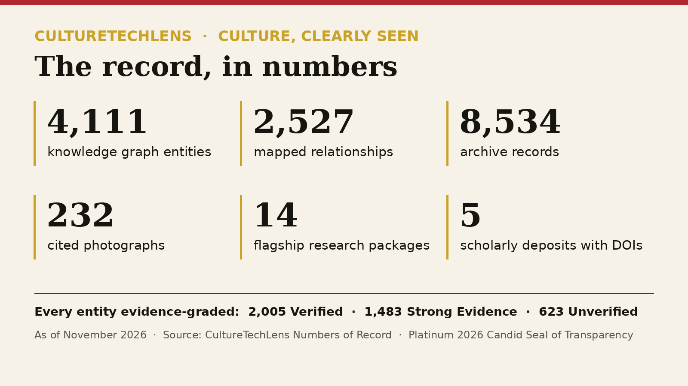
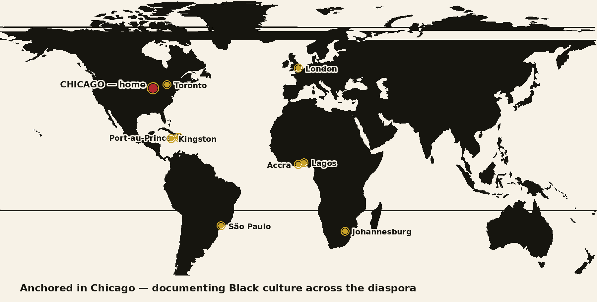

# CultureTechLens

**Culture, Clearly Seen.**

CultureTechLens is a Chicago-based Black cultural intelligence platform — a 501(c)(3) nonprofit archive, research, and publishing institution founded by William Maxey. It exists to answer one question: *Who is missing from the record?*

## Coverage

## Start here

- **[culturetechlens](https://github.com/culturetechlens/culturetechlens)** — the flagship repository: the Black Cultural Knowledge Graph and the institution's public home on GitHub.
- **[culturetechlens-research](https://github.com/culturetechlens/culturetechlens-research)** — research packages, briefs, and dossiers.
- **[culturetechlens-index](https://github.com/culturetechlens/culturetechlens-index)** — the CultureTechLens Index, the monthly data-driven ranking of Black cultural resonance.
- **[culturetechlens-knowledge-graph](https://github.com/culturetechlens/culturetechlens-knowledge-graph)** — the archived seed of the knowledge graph.

## Cite and license

The graph and datasets are the citable source of truth behind [culturetechlens.com](https://culturetechlens.com). Every claim is evidence-graded, and corrections are logged in public. Licensing enquiries from libraries and institutions: **info@culturetechlens.com** · Press: **press@culturetechlens.com**

Wikidata: [Q141705779](https://www.wikidata.org/wiki/Q141705779) · Founder ORCID: [0009-0004-2837-8037](https://orcid.org/0009-0004-2837-8037)

*CultureTechLens NFP · 501(c)(3) nonprofit · EIN 39-3143901 · PO Box 379244, Chicago, IL 60637*
